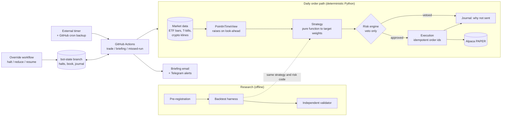

# Systematic trading research, built to say no

A paper-trading research framework for US ETFs, with crypto data used as a
signal. Strategies are pure functions of point-in-time data. A deterministic
risk layer vetoes any order that would breach the limits, and **no model sits
in the order path**. Every idea is pre-registered, tested once, and judged by
an independent validator.

**Four trials tested so far, four FAILs, and one idea withdrawn before
testing.** That is the intended outcome of a process designed to stop a
backtest from lying, and every one of them is published below.

*Paper trading only. Nothing here is investment advice. The full system lives
in a private repository; this repo is a self-contained extract (see
[`code/`](code/)).*

## Architecture



Each scheduled run checks out an orphan `bot-state` branch as its state
directory, runs the bot unchanged, and commits what it wrote. Runners keep
nothing between jobs, so this is what lets halts and the book survive.
Runs are dispatched at exact New York times by an external timer, with
GitHub's own cron as a backup. Whichever fires second is a no-op.

## Key engineering decisions

- **Look-ahead is impossible by construction.** Strategies never receive a
  DataFrame. They get a view truncated at the decision timestamp, which
  raises if asked for anything later. Event-stamped sources, such as weekend
  crypto variance known at 13:00 UTC on Monday, are bounded by the exact
  execution instant, not by the bar date.
  ([`pit.py`](code/src/tradingbot/data/pit.py))
- **Deterministic risk veto.** Every limit in `limits.yaml` is enforced in code
  and tested by a suite whose only job is to breach it: daily and weekly loss,
  drawdown warning and stop, exposure, no leverage, no shorting. The **same
  engine** runs inside the backtest, so research results are measured under
  the limits the live system enforces.
  ([`engine.py`](code/src/tradingbot/risk/engine.py))
- **Authority is asymmetric.** Anyone or anything may halt or reduce risk at
  any time. Resuming needs a written reason and a named human, and a full
  halt never lifts itself.
- **Fail-closed state.** A missing state file is a first run. A *corrupt*
  one is a FULL halt, and the file is then never overwritten, so the evidence
  is kept. A state branch that cannot be reached is an error, not a fresh
  start.
- **Idempotent orders.** The client order id is a stable hash of
  `(session, strategy, symbol)`. Quantity, clock and process are deliberately
  excluded. A retried run after a crash is rejected by the broker as a
  duplicate instead of filling twice.
- **DST-correct NY scheduling.** The trading gate is 09:45 America/New_York,
  derived from the session-edge limit rather than hard-coded. Cron coverage
  is *computed* and tested against every NYSE session in 2026-2027, including
  the weeks when the UK and US clocks disagree, and with late fires.
- **Kill switch and reconciliation.** The book is reconciled against the
  broker before every run. A mismatch halts trading and is never
  auto-corrected. Loss halts FLATTEN the book; integrity halts FREEZE it, and
  then not even sells are sent.
- **Paper by default.** Orders are sent only when a repository variable is
  exactly `true`. Every other run is a dry run.

## Research protocol

1. **Pre-registration first.** Hypothesis, rule, sample, costs, control,
   pass/fail criteria and a stated prior are written and merged *before* any
   strategy code exists. After merge, nothing above "Results" changes.
2. **Fixed samples.** Evaluation windows are set by publication date and data
   availability. Other windows may appear only as disclosed robustness and
   cannot rescue a FAIL.
3. **One run.** No parameter sweeps. A strategy that fails is not tuned and
   re-run; a variant is a new trial.
4. **Deflated Sharpe with a trial count.** A registry records every candidate
   ever tested, failures included. `n_trials` and the cross-trial Sharpe
   dispersion feed the deflated Sharpe ratio, so each new idea faces a higher
   bar. ([`metrics.py`](code/src/tradingbot/research/metrics.py))
5. **Permutation tests.** The deciding test permutes returns in a way that
   matches the claim. For example, the turn-of-month trial keeps the
   calendar and shuffles the returns. A separate leakage gate fails any
   strategy that keeps its edge on shuffled data.
   ([`validation.py`](code/src/tradingbot/research/validation.py))
6. **Independent validator.** A read-only reviewer agent, whose brief is to
   kill the strategy, reproduces every deciding number before a verdict is
   recorded.
7. **Regression gate.** Before a new trial runs, earlier trials' headline
   numbers must reproduce. If they do not, the work stops until a human
   decides.
8. **Data manifests.** `--manifest` records the path, row count, date range
   and SHA-256 of every data file a validation run read.
   ([`manifest.py`](code/src/tradingbot/research/manifest.py))

Costs are 6 bp one way for ETFs, deliberately pessimistic and never lowered to
rescue a result. Crypto costs have a floor, and a crypto strategy must also
pass at double cost.

## Results

| # | Trial | Idea | Verdict | Deciding numbers | Registry Sharpe IS / OOS, recorded → corrected harness |
|---|---|---|---|---|---|
| 1 | [`crypto_weekend_vol`](docs/trials/crypto_weekend_vol.md) | Weekend crypto variance improves SPY vol-targeting | **FAIL** | Forecast vs no-crypto baseline: 1.05% *worse*, DM p = 0.66 | 0.7132 / 0.5401 → **0.8904 / 0.7729** |
| 2 | [`crypto_weekend_monday`](docs/trials/crypto_weekend_monday.md) | The same, at the Monday horizon, beyond HAR + VIX | **FAIL** | Forecast loss 3.83% lower, p = **0.0506** vs 0.05: inconclusive | 0.5108 / 0.5573 → **0.7943 / 0.7500** |
| 3 | [`trend_spy_gld`](docs/trials/trend_spy_gld.md) | 10-month trend filter on SPY + GLD | **FAIL** | Sharpe 0.654 vs control 0.728; permutation p = 0.15 | 0.5584 / 0.5584 → **0.4575 / 0.4575** |
| – | [`month_end_flows`](docs/trials/month_end_flows.md) | Front-run 60/40 rebalancing flows | **WITHDRAWN** | Ex-ante costs ~5-6.5%/yr vs ~10% gross; never run, not counted | – |
| 4 | [`turn_of_month`](docs/trials/turn_of_month.md) | Hold SPY only over Day −1..+3 | **FAIL** | Sharpe 0.153 vs buy-and-hold 0.585, loses at zero cost; permutation p = 0.31 | −0.2304 / −0.2304 → **−0.2304 / −0.2304** |

**What the last column means.** The registry Sharpe is the *risk-enforced*
backtest Sharpe that feeds every later trial's deflated-Sharpe calculation. In
October 2026 two bugs were found in the harness's risk checks: the daily-loss
check never fired, and the weekly-loss check dropped each week's last session.
Both were fixed, and every trial was re-measured. The recorded values are kept
as what each trial was judged on, and the corrected values sit alongside them.
**No verdict changed.** Trials 3 and 4 were scored on runs without risk
limits, so their criteria do not move. Equity curves:
[`docs/figures/`](docs/figures/).

## Lessons learned

- **Test the measuring instrument.** Trial 1's first run went through a
  harness with six bugs and measured the harness, not the strategy. Two more
  bugs in the risk checks surfaced later. Each fix came with a test proving
  the check fires.
- **A better forecast is not a better portfolio.** A volatility-forecast gain
  has to survive sizing, costs and a fully invested benchmark. In trial 1,
  vol-targeting did all the work, and the control existed to show exactly
  that.
- **Pre-register the implementation, not just the test's name.** Trial 2's
  p = 0.0506 turned on a small-sample correction the pre-registration had not
  pinned down. It is recorded as inconclusive, and later pre-registrations
  specify such choices in full.
- **Drawdown reduction is not an edge.** Trial 3 halved the drawdown, mostly
  because of 2008, and lost Sharpe. Drawdown was dropped as a success
  criterion afterwards.
- **Published anomalies decay.** The turn-of-month effect was absent on SPY
  after publication, and random days did as well.
- **Cheap kills are the best kills.** Writing turnover and cost arithmetic into
  a pre-registration withdrew `month_end_flows` without spending a trial.
- **Stop rules need a human.** When a pre-registered gate is not literally met,
  the work halts and a person decides. Disclosed deviations are part of the
  record.
- **Pick the benchmark that tests something.** A risk-enforced buy-and-hold
  SPY hits its permanent drawdown stop in 2018 and is flat from then on, so
  strategies are compared with *unenforced* buy-and-hold.

## Stack

Python 3.11-3.13 · pandas · NumPy · SciPy · PyArrow · pytest (777 tests in the
full system) · ruff · mypy ·
GitHub Actions (scheduled runs, CI, branch protection, CODEOWNERS on risk and
execution paths) · Alpaca paper-trading API · Yahoo Finance, FRED and Binance
public data · Claude Code agents for research, review and adversarial
validation, never in the order path.

## This repository

```
README.md            this page
docs/trials/         one page per trial: hypothesis, rule, criteria, result, lesson
docs/figures/        strategy vs control equity curves (research data only)
scripts/             make_figures.py: how the figures were generated
code/                runnable extract: PIT view, backtest, metrics, validation,
                     manifest, risk engine, two strategies, 145 tests
```

`code/` runs on its own on synthetic data. See [`code/README.md`](code/README.md).
No data files are committed.

MIT licensed.
