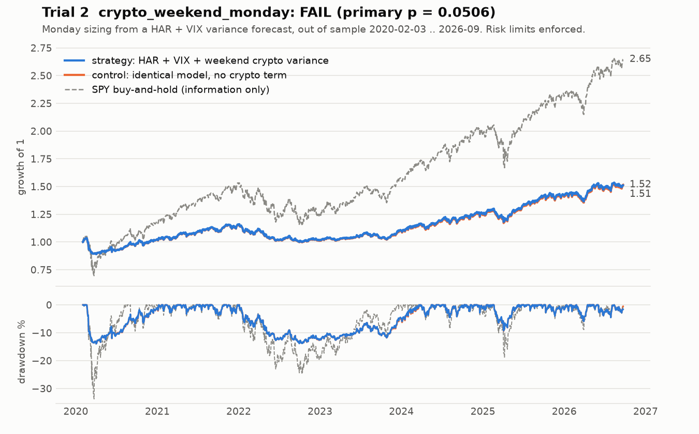

# Trial 2: `crypto_weekend_monday`: FAIL (inconclusive at the pre-registered threshold)

| | |
|---|---|
| Registered | 2026-09-21, after trial 1 failed; the relation to trial 1 is disclosed up front |
| Tested | 2026-09-22, once |
| Verdict | **FAIL**: primary criterion missed on significance (p = 0.0506 vs 0.05) |
| Priors, stated before testing | primary criterion ~25%; all promotion criteria ~5% |

*Corrected harness. The arms differ only in Monday sizing, so the lines nearly
coincide. The control has the higher Sharpe (0.7555 vs 0.7500), and both
trail buy-and-hold (0.8302).*

## Hypothesis

Trial 1 forecast the **mean variance over the whole week**. The underlying
finding was about **Monday**, so trial 1 diluted a one-day effect across five
days. Trial 2 tests the finding at the horizon where it was found:

> Weekend crypto realised variance improves the out-of-sample forecast of
> SPY's Monday intraday variance beyond a HAR model that already includes VIX.

Trial 1's evidence (VIX absorbed the crypto term at the weekly horizon) counted
against this trial, and its prior was set lower because of it.

## Rule

- Target: Monday's Garman-Klass variance, open to close. This excludes the
  weekend gap on purpose, because the position is entered at Monday's open.
- Two models, fitted by OLS on Monday observations only. Expanding window,
  first forecast after 104 Mondays:
  - **Crypto:** `ln RV_Mon ~ ln RV_d + ln RV_w + ln RV_m + ln VIX + ln WV`
  - **Baseline:** the same without `ln WV`
- Monday weight `clip(10% / forecast vol, 0, 1)`. Tuesday to Friday, both arms
  hold the identical weekly vol-target weight. The two strategies differ
  **only** in Monday sizing, and only through the crypto term.
- One parameter set. Costs are 6 bp one way.

## Criteria (fixed before the run)

**Primary (the research question):** Diebold-Mariano test on QLIKE loss,
crypto vs baseline, over all out-of-sample Mondays, with a Newey-West
bandwidth fixed in advance. **Pass:** lower mean loss **and** two-sided
p < 0.05.

**Promotion:** all of OOS Sharpe above buy-and-hold and above 0.8;
risk-enforced max drawdown below 15%; deflated Sharpe above 0.95; the
primary criterion passes; at least 20 decisions, and the edge survives
removing the best 3 weeks.

## Result

346 out-of-sample Mondays, 2020-02-03 to 2026-09-14.

| | Result | Verdict |
|---|---|---|
| **Primary** | crypto loss **3.83% lower** (the predicted direction); two-sided **p = 0.0506** | **FAIL** |
| 1. OOS Sharpe | 0.5573 vs buy-and-hold 0.8302 (recorded); **0.7500** on the corrected harness | FAIL |
| 2. Max drawdown | 13.8% with the risk layer; 16.0% without it | PASS |
| 3. Deflated Sharpe | 0.816 | FAIL |
| 5. Robustness | trimmed edge does not beat the baseline | FAIL |

**Why this counts as a FAIL, not a near-pass.** The pre-registration fixed the
loss, alpha and bandwidth. It did not name a small-sample correction or a
reference distribution. Of the four defensible combinations, three reject at
5% and one does not. The one used was the trial-1 implementation, byte for
byte. It was fixed before this trial's data was seen, so it counts as a
pre-commitment and not as a choice made after seeing the result. The
model-confidence-set p-value (0.053) tells the same story: the data cannot
separate the two models.

Two more fragilities were reported, not hidden:

- Two Mondays supply 47% of the loss differential.
- Across sample start dates that were all defensible beforehand, the p-value
  ranges from 0.019 to 0.56.

**The one result that went the hypothesis's way.** At the Monday horizon the
crypto term **survives** the VIX control (−3.83% with VIX, −5.60% without). At
the weekly horizon in trial 1 it was significantly worse with VIX.

**Corrected-harness note (2026-10).** Recorded in-sample / OOS Sharpe
**0.5108 / 0.5573**; on the corrected harness **0.7943 / 0.7500**. No
verdict changes.

## What it taught

- **"Fails by 0.0006" is not a summary.** The honest description is
  *inconclusive at a pre-registered 5% threshold*, recorded as FAIL because
  that is what the rule written before the test says.
- **Name the knobs so nobody turns them.** The Results write-up lists the
  changes that would turn this into a pass (an earlier start date, a normal
  reference distribution, a different bandwidth). They are listed so that
  they are *not* made. Any variant is a new registered trial and raises the
  bar for everything after it.
- **Pre-register the implementation, not just the test name.** "Diebold-Mariano
  at 5%" left room for four answers. Later pre-registrations pin the
  correction and reference distribution as well.
- **A forecasting win and a trading win are different questions.** Even a
  clean pass on the primary criterion would have moved the book one day in
  five, which is too little to matter after costs.
