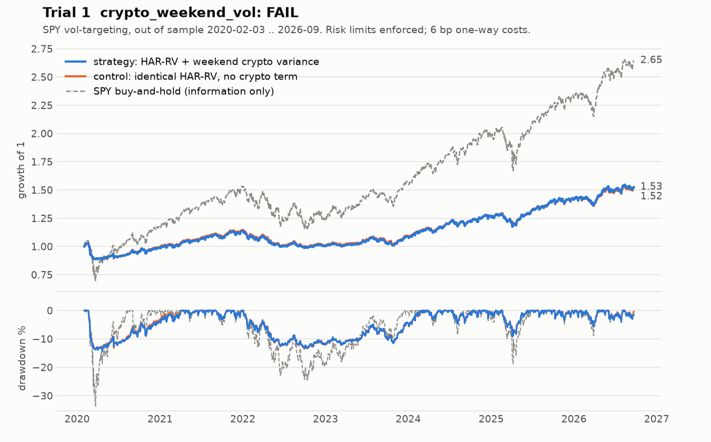

# Trial 1: `crypto_weekend_vol`: FAIL

| | |
|---|---|
| Registered | 2026-09-16, before any backtest |
| Tested | v1 2026-09-16; v2 2026-09-21 (same strategy code, repaired harness) |
| Verdict | **FAIL**: 5 of 6 criteria failed, including the one that mattered |
| Prior, stated before testing | ~30% that the deciding criterion passes |

*Corrected harness. The two lines nearly coincide: the crypto term barely
changes the sizing. The strategy ends marginally higher in total return, but
the control has the higher Sharpe (0.7876 vs 0.7729), and both trail
buy-and-hold (0.8302). The verdict rests on forecast accuracy (criterion 4),
not on the small gap between these lines.*

## Hypothesis

Crypto trades through the weekend while US equities do not. The idea was that
weekend realised variance in BTC and ETH predicts US equity volatility the
following week. The motivation was an earlier academic result (a dissertation
by the author) that found a cross-asset volatility link emerging after 2024.

The claim was about **volatility, not direction**. A volatility forecast says
how far the market is likely to move, not which way. So the strategy only
sizes a long position. It never shorts, never levers and never times the
market.

## Rule

- Weekly decision at Monday's open, SPY only.
- Forecast next week's SPY volatility with a HAR-RV model (daily, weekly and
  monthly realised-variance terms) plus `log(weekend crypto variance)`.
  Refit on an expanding window with at least 104 weeks of history.
- Weight `w = clip(10% / predicted_vol, 0, 1)`.
- The weekend window ends **before** Monday's US open. Any overlap would be
  look-ahead, and the point-in-time view raises if the code asks for it.
- One parameter set, fixed in advance. Costs are 6 bp one way.

**Control:** the identical HAR-RV vol-targeting rule *without* the crypto
term. Vol-targeting is a known effect. The crypto term is the only thing
under test.

## Criteria (all must pass, fixed before the run)

1. Out-of-sample Sharpe above buy-and-hold SPY, and above 0.8.
2. Out-of-sample max drawdown below 15%.
3. Deflated Sharpe probability above 0.95 at the registry's trial count.
4. **Diebold-Mariano test: the crypto forecast beats the no-crypto baseline
   at 5%.** This was the deciding criterion.
5. The shuffle (leakage) test does not flag it.
6. No dependence on a handful of weeks: at least 20 decisions, and the edge
   survives removing the best 3 weeks.

## Result

Out of sample from 2020-02-03 (when the 104-week burn-in ends) to 2026-09:

| | Result | Verdict |
|---|---|---|
| 4. DM on QLIKE loss, crypto vs baseline | crypto loss **1.05% higher** (wrong direction), p = 0.66 | **FAIL** |
| 1. OOS Sharpe | 0.5401 vs buy-and-hold 0.8168 (recorded); **0.7729** on the corrected harness | FAIL |
| 2. Max drawdown | 13.4%, but only because the risk layer cut exposure on 24% of days. Without limits it was 16.1% | PASS |
| 3. Deflated Sharpe | 0.913 | FAIL |
| 6. Robustness | edge does not survive removing the best 3 weeks | FAIL |

- The crypto-augmented forecast was **not better** than the baseline. Its
  loss was slightly *worse*. A model-confidence-set test kept both models: the
  data could not separate them.
- With a VIX control added (a failure mode named in the pre-registration), the
  crypto term made the forecast **significantly worse** (+6.8% QLIKE,
  p = 0.005). It was a noisy proxy for information that VIX already carries.
- The validator rebuilt the entire forecast pipeline from raw files without
  importing project code. Its forecasts matched to 1e-16.

**Why there are two result sets.** The v1 run went through a harness with six
bugs. The worst was a drawdown-warning rule that permanently halted the book,
which then sat flat for almost the whole test. v1 measured the harness, not
the strategy. The harness was fixed and tested, and the **unchanged** strategy
was re-run. The verdict did not move, and criterion 4 (which does not depend
on the harness) gave the same number both times. This is recorded as a
re-measurement of the same trial, not a new one.

**Corrected-harness note (2026-10).** Two later fixes changed the risk-enforced
Sharpe: a daily-loss check that never fired, and a weekly-loss check that
dropped the last session of each week. Recorded in-sample / OOS Sharpe
**0.7132 / 0.5401**; on the corrected harness **0.8904 / 0.7729**. Every
criterion verdict is unchanged. The recorded values are kept, because they are
what the trial was judged on.

## What it taught

- **A better forecast is not a better portfolio.** The literature result was
  about forecasting. Even a real forecast gain has to survive conversion into
  position sizes, costs and a benchmark that is simply fully invested.
- **Vol-targeting did all the work.** That is exactly why the control existed.
  Without it, a "pass" on Sharpe or drawdown would have credited the crypto
  term for a known effect.
- **Test the measuring instrument first.** Six harness bugs produced a
  confident-looking v1. The response was more tests on the harness (zero
  signal gives zero P&L, halts behave as specified, costs are charged), not a
  different strategy.
