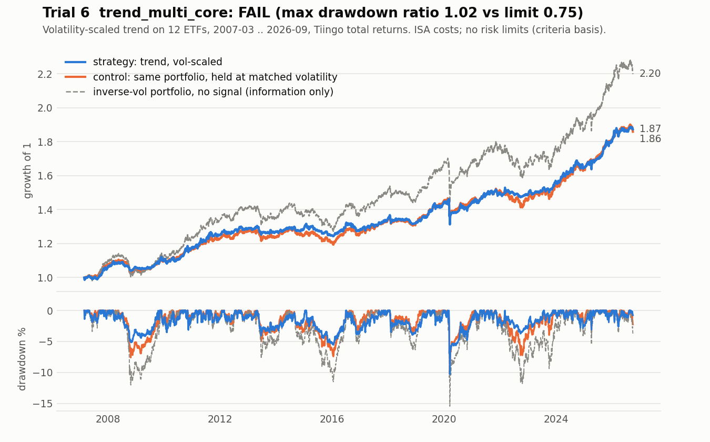

# Trial 6: `trend_multi_core`: FAIL

| | |
|---|---|
| Registered | 2026-10-26, before any backtest |
| Tested | 2026-10-28, once, from a clean commit, with a data manifest |
| Verdict | **FAIL**: criterion 2 (drawdown) fails on both data sources; the tail improvement is real but marginal |
| Priors, stated before testing | all criteria ~3%; "inconclusive but favourable" ~27%; control wins or fail ~70% |

## Hypothesis

A long-or-cash, volatility-scaled portfolio of 12 ETFs held in proportion to a
trend signal has a **smaller worst-month loss and a smaller maximum
drawdown than the same portfolio held without the signal and scaled to the
same volatility**, at no material Sharpe cost, after ISA-level trading costs.
The window is 2007-03-01 to 2026-09-30, and the result has to hold on **both**
Tiingo and Yahoo total returns.

The claim is about the shape of the loss distribution, not the mean. With 19
years of data a Sharpe gain of the size the literature allows cannot be
detected, so the registered claim is the one the sample can speak to, with
Sharpe only as a non-inferiority bound.

This is trend-timing again. Trial 3 was the same idea on two assets and
failed. The pre-registration said so, said what differed, and said that a
FAIL here **retires trend-timing from the project**.

## Rule

- **Universe, fixed:** 12 ETFs in three buckets. Equities: SPY, IWM, IEV, EWJ,
  EEM, IYR. Bonds: IEF, TLT, TIP, LQD. Real assets: GLD, DBC. Nothing added or
  dropped after seeing results.
- **Signal:** for each ETF and each lookback of 21, 63 and 252 sessions, 1 if
  its trailing total return beats the T-bill return over the same span. The
  signal is the mean of the three, so it takes the values 0, ⅓, ⅔ and 1. The
  lookbacks are the literature's, not fitted.
- **Sizing:** 10% total risk budget split equally across the buckets, each
  ETF sized by inverse volatility (63-day), capped at 25% each, and scaled so
  the total is at most 99.8% invested. The trend weight is the signal times
  the control weight. A switched-off sleeve goes to cash.
- **Trading:** a target each week, averaged over the last four weeks, filled at
  the next session's close, with a 0.5% rebalance band.
- **Costs:** an assumed ISA schedule of 10-20 bp a side by ETF, plus 1 bp on
  the cash leg, never lowered. Doubled and lower variants are reported only.

**Primary control:** the identical code with the signal switched off (an
inverse-volatility portfolio of the same 12 ETFs). Any difference is the
signal alone.

**Tail control:** the primary control blended with cash to match the trend
arm's volatility. Criteria 1, 2 and 4 are scored against this, so that a
smaller loss means better timing, not less exposure. This is the lesson of
trials 3 to 5: a strategy that is often in cash has a smaller drawdown
whatever its timing.

SPY buy-and-hold and a 60/40 portfolio are reported for context only.

## Criteria (all five, on both data sources, fixed before the run)

1. **Tail.** The average of the 12 worst months (CVaR at 5%) is lower than the
   volatility-matched control's, with a one-sided block-bootstrap p < 0.05.
   The test was chosen by comparing six candidates on synthetic data for power
   and false-pass rate. The pre-registration records that choice.
2. **Drawdown.** Maximum drawdown at most **0.75 times** the volatility-matched
   control's.
3. **Sharpe non-inferiority.** Sharpe no more than 0.10 below the primary
   control's.
4. **Both halves.** The tail improvement is positive in 2007-2016 *and*
   2017-2026.
5. **Leakage gate.** Every weight uses only data dated at least two sessions
   earlier, shown by truncation equality and a timing check, and the
   shuffled-history t is at most 2.

The pre-registration fixed the **outcome tiers** and the action for each in
advance: STRONG PASS, PASS, INCONCLUSIVE (FAVOURABLE), CONTROL WINS and FAIL.
Even a PASS was not a promotion.

## Result

| # | Criterion | Tiingo | Yahoo | Verdict |
|---|---|---|---|---|
| 1 | CVaR(5%): trend vs matched control; bootstrap p | 1.95% vs 2.29%; **p = 0.042** | 1.95% vs 2.30%; **p = 0.049** | PASS both |
| 2 | Max drawdown, trend / matched control | 10.28% / 10.07% = **1.021** | 10.28% / 10.06% = **1.022** | **FAIL** both (limit 0.75) |
| 3 | Sharpe vs primary control | +0.024 | +0.023 | PASS both |
| 4 | Tail gain in each half | 0.50% / 0.18% | 0.52% / 0.18% | PASS both |
| 5 | Leakage gate | t = −6.20 | t = −3.81 | PASS both |

All five on both sources were required. **FAIL.**

- **The tail improved a little.** The average of the 12 worst months was 1.95%
  against 2.29% at matched volatility. It is positive in both halves and on
  both sources, but it is close to the line. Yahoo's p is 0.0490 against 0.05,
  and the same statistic fails on excess returns (p 0.052 / 0.059), on
  doubled costs (0.068 / 0.078), from 2010 on (0.060 / 0.061) and in the GBP
  view (0.095 / 0.093). Dropping September 2008 to March 2009 halves it.
- **The drawdown did not improve at all.** Both arms' worst drawdown is the
  March 2020 crash, about 10.3% against 10.1%. In early March the trend arm
  was still about 80% invested, mostly in bonds, credit and gold, whose
  signals were all still on. The equity signals had already switched off.
- **There is no Sharpe edge.** The Sharpe difference is +0.024 with a 95%
  interval of roughly −0.16 to +0.25.
- **Trend costs real money.** It turns over 2.8 times a year against 0.8 for the
  control and pays about 0.5% a year in costs, about 10% of NAV over the window.
  The tail result survives lower costs and not doubled ISA costs.
- **It is not random.** Against 1,000 signals shifted at random, the real tail
  gain ranks 2nd (empirical p = 0.002). That is the strongest support in the
  output. It is reported, not deciding, and it cannot rescue a failed
  criterion.
- **Survivorship works in its favour.** The 12 ETFs were chosen in 2026 and all
  survived to 2026. The arm still failed.

Which tier? INCONCLUSIVE (FAVOURABLE) needed every point estimate to favour
trend, including a drawdown ratio of at most 0.75: it is 1.02. CONTROL WINS
needed criterion 1 to fail on both sources: it passed on both. So the rule
written before the test gives FAIL.

**The pre-registered action was applied as written:** trend-timing is retired
as a research direction, no variant is queued, and nothing here establishes
the control as an ISA holding.

**Pre-run review, disclosed.** A human review of the implementation, before the
run, added a ruling for one ambiguous combination of outcomes and hardened
several stop conditions. The ruling was not triggered. No criterion, window,
cost, control or test changed. Nothing was re-run.

An independent validator agent wrote its own implementation from the
pre-registration text and reproduced every deciding number on both sources,
including the bootstrap p-values exactly. It also found one inconsistency in a
diagnostic line that decides nothing (a control-blend parameter held fixed in
one number and re-estimated in the next). It was disclosed, not fixed.

**Corrected-harness note.** This trial ran on the corrected harness. The
registry Sharpe, **0.4884**, is the risk-enforced run, which halted twice on
2020-03-13. The unenforced Sharpe is 0.4692. Reported deflated Sharpe: 0.258
and 0.355 against 0.95. It decided nothing.

## What it taught

- **Match the control to the claim.** Against the fully invested control, the
  trend arm's drawdown was 0.665 of the control's, which would pass. That is
  the effect of holding less (52% invested against 86%), which the matched
  control gets for free. The obvious rescue was written into the Results as
  *not available*.
- **A marginal pass on one criterion is not a pass.** Criterion 1 passed by
  0.001 on Yahoo and fails under five reasonable variations. The registered
  five-criterion rule is what stopped a narrow win from being presented as a
  result.
- **The drawdown failure is one episode.** Both arms' maximum drawdown is March
  2020. Before 2020 the ratio is about 0.73. The reviewer reported this as
  information. No secondary window is allowed to rescue a FAIL, and none was
  claimed.
- **Fix the verdict tiers and actions in advance.** With "inconclusive but
  favourable" defined beforehand, no one could invent a softer verdict
  afterwards. The prior was 3% for a pass and about 70% for control-wins or
  fail.
- **Run the second data source.** Tiingo and Yahoo agreed closely, and the gap
  that exists (one commodity ETF in late 2008) is exactly what moved the tail
  p from 0.042 to 0.049.
- **Power sets what you may claim.** At 235 months, a Sharpe gain cannot be
  detected, and a tail effect barely can. That is why the claim was about the
  tail, and why the useful alternative result was "the bot is not needed".
- **Name the rescues so they are not tried.** A looser drawdown limit, a
  different drawdown definition, dropping March 2020, judging criterion 1
  alone, a faster signal, other lookbacks or lower costs would each be a new
  trial.
