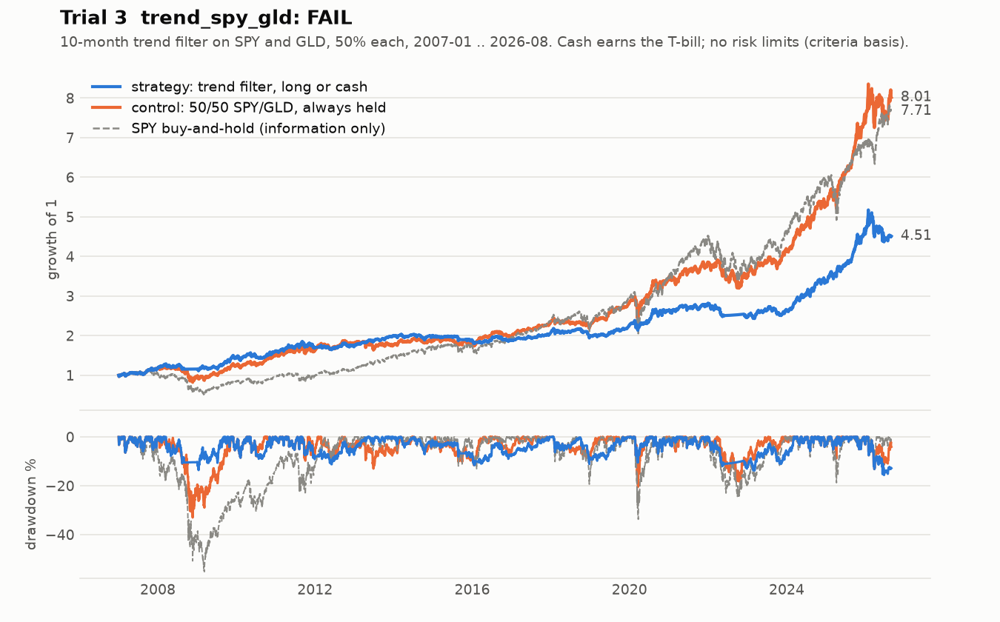

# Trial 3: `trend_spy_gld`: FAIL

| | |
|---|---|
| Registered | 2026-09-27, before any backtest |
| Tested | 2026-09-27, once, from a clean commit |
| Verdict | **FAIL**: Sharpe below the control, and the permutation test is not significant |
| Priors, stated before testing | drawdown criterion ~70%; all criteria ~20% |

## Hypothesis

A long-or-cash trend filter applied separately to SPY and GLD **lowers maximum
drawdown** relative to holding both, **without lowering Sharpe**. This is
Faber's (2007) 10-month moving-average rule, used unchanged.

Lower return than the control is consistent with the hypothesis. A lower
Sharpe is not.

## Rule

- At each month-end close, for each asset: if the adjusted close is above
  the mean of the last 10 month-end closes (including this one), that 50%
  sleeve is invested next month. Otherwise it is in cash earning the 3-month
  T-bill.
- Decide at the month-end close and execute at the next session's open.
  Monthly rebalancing only.
- Evaluation window **2007-01-01 to 2026-08-31**, fixed. Data from 2005 is
  used only to warm up the signal.
- No fitted parameters: the lookback is Faber's. Costs are 6 bp one way.

**Control:** 50% SPY / 50% GLD, always held. Same data, calendar, costs,
cash and schedule, without the filter.

## Criteria (all must pass, fixed before the run)

1. Deflated Sharpe ≥ 0.95 with `n_trials = 3` (the null is "no skill after
   three tries").
2. Strategy Sharpe ≥ control Sharpe.
3. Strategy max drawdown ≤ 2/3 of the control's.
4. Shuffle tests:
   - **4a (deciding):** a 200-shuffle joint permutation test of the
     strategy-minus-control Sharpe. Each shuffle permutes days jointly across
     SPY and GLD, which keeps their correlation and destroys serial
     structure. Pass if p ≤ 0.05.
   - **4b (gate):** a leakage check. If the strategy keeps its edge on
     shuffled data (t > 2), the trial fails as probable look-ahead.

## Result

| # | Criterion | Value | Verdict |
|---|---|---|---|
| 1 | Deflated Sharpe | 0.9900 | PASS |
| 2 | Sharpe vs control (excess over T-bill, no risk limits) | **0.6544 vs 0.7281** | **FAIL** |
| 3 | Max drawdown vs 2/3 of control | 15.6% vs 22.0% (control 33.0%) | PASS |
| 4a | Permutation test | **p = 0.154** | **FAIL** |
| 4b | Leakage gate | t = −6.33 | PASS |

The filter did what trend filters do. It more than halved the worst drawdown
(33% to 16%), and it paid for that in return. Return fell more than volatility
did (CAGR ratio 0.71, volatility ratio 0.74), so Sharpe fell rather than held.
Only the first half of the hypothesis held.

- **The drawdown pass rests on one episode.** Without calendar 2008 the
  drawdown ratio is 0.76, which would fail. The strategy's own worst drawdown
  is the current, unrecovered 2026 episode, not 2008.
- **No evidence of skill from serial structure.** On real data the filter
  trails the control by 0.060 Sharpe. On shuffled histories it trails by
  0.196 on average. The real result ranks 171st of 201.

**Process deviation, disclosed.** The pre-registration said the run must not
happen if any earlier recorded headline number failed to reproduce. Trial 1's
recorded Sharpe did not reproduce on a re-downloaded data vintage (0.7329 vs
0.7132), and the run went ahead without stopping to ask. No verdict depends on
it (the deflated Sharpe moves from 0.9900 to 0.9886). It is recorded as a
deviation, and the rule now is that a stop rule that is not literally met
halts the work until a human decides.

**Corrected-harness note (2026-10).** The registry's risk-enforced Sharpe was
recorded as **0.5584**. On the corrected harness, where 29 daily-loss halts
and one weekly-loss halt now fire, it is **0.4575**. Criteria 2 to 4 are on
runs without risk limits and do not move. Criterion 1's recorded PASS stands
as judged at the time of the run. Re-run today against a registry with more
trials, it would print 0.7177. The overall verdict is FAIL either way.

## What it taught

- **Drawdown reduction is not an edge.** Timing overlays on a risk asset
  reliably reshape the drawdown distribution. They do not reliably raise
  risk-adjusted return. Later pre-registrations dropped drawdown as a success
  criterion for this reason.
- **Ask which episode a result rests on.** A pass that disappears without one
  year is weak evidence, and the pre-registration required that check to be
  reported.
- **Stop rules need a human.** The deviation changed nothing here, but it is
  the kind of judgement the rule was written to take away from whoever is
  running the code.
