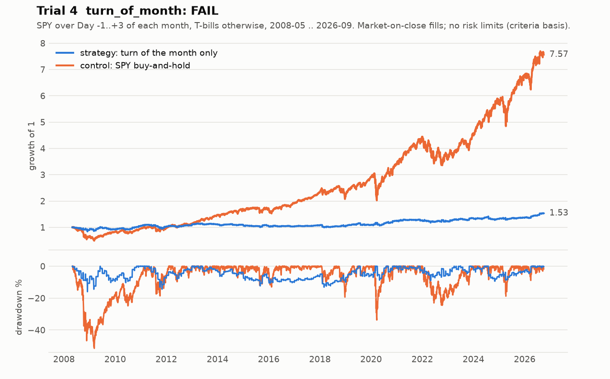

# Trial 4: `turn_of_month`: FAIL

| | |
|---|---|
| Registered | 2026-10-07, before any backtest |
| Tested | 2026-10-07, once, from a clean commit, with a data manifest |
| Verdict | **FAIL**: lower Sharpe than buy-and-hold even at zero cost; no better than random days |
| Priors, stated before testing | Sharpe criterion ~25%; permutation test ~15%; all criteria ~12% |

## Hypothesis

Holding SPY only over the four-session **turn of the month** gives a higher
Sharpe than holding SPY throughout, after costs. The turn of the month is the
last trading day of a month plus the first three of the next. Outside that
window the book holds 3-month T-bills. The rule is McConnell and Xu (2008),
used unchanged, and it is tested **only on data after the paper was
published**.

The pre-registration states the arithmetic up front. The strategy is invested
about 19% of the time. To match buy-and-hold's Sharpe, those days must carry
about √0.19 ≈ 44% of the whole excess return, plus enough to cover costs.
Lower volatility and drawdown are *not* support: they follow mechanically
from being out of the market 81% of the time.

The pre-registration also disclosed that a recent study already reports the
effect gone after 2001.

## Rule

- Hold SPY from the close of Day −2 to the close of Day +3, using
  market-on-close fills. That captures exactly the paper's four
  close-to-close returns: Days −1, +1, +2 and +3.
- Days −2 and −1 come from a rules-based NYSE calendar that is knowable in
  advance. Days +1 to +3 come from the data. One-off closures (Hurricane Sandy,
  2012) are handled the way a trader using the scheduled calendar would have
  handled them, and reported.
- Evaluation window **2008-05-01 to 2026-09-30**, entirely after the
  authors' sample and their publication.
- No fitted parameters. Costs are 6 bp one way, about 1.4% a year of drag
  for the strategy.

**Control:** SPY buy-and-hold. Same data, window, fills, costs and cash
accrual.

## Criteria (all must pass, fixed before the run)

1. Deflated Sharpe ≥ 0.95 with `n_trials = 4`.
2. Strategy Sharpe ≥ buy-and-hold Sharpe, both on returns in excess of the
   T-bill.
3. *No drawdown criterion, by design.* This is the lesson from trial 3.
4. Shuffle tests:
   - **4a (deciding):** a 200-shuffle permutation test. SPY's daily returns
     are permuted and the dates kept, so the strategy is still invested on
     Days −1 to +3, but now holding returns drawn from random days. Pass if
     p ≤ 0.05.
   - **4b (gate):** the leakage check.

## Result

| # | Criterion | Value | Verdict |
|---|---|---|---|
| 1 | Deflated Sharpe | 0.108 | **FAIL** |
| 2 | Sharpe vs buy-and-hold (excess, no risk limits) | **0.1525 vs 0.5853** | **FAIL** |
| 4a | Permutation test | **p = 0.31** | **FAIL** |
| 4b | Leakage gate | t = −6.67 | PASS |

- **The turn-of-month days carried too little of the premium.** They carried
  24% of SPY's summed excess return on 19% of sessions, against the 44%
  needed. Day −1, the paper's strongest day, averaged **−0.044%**.
- **It loses before costs as well.** At zero cost the Sharpe is 0.33 against
  0.59, so no break-even cost exists.
- **Random days do as well.** On shuffled histories with the same exposure,
  the strategy-minus-control Sharpe averages −0.570. The real −0.470 ranks
  140th of 201.
- **The live risk layer would have stopped it.** In the risk-enforced run, a
  one-session jump in drawdown during the November/December 2008 window
  tripped the permanent 15% drawdown stop.

**Deviations, both decided by a human before the run and recorded:**

- The trial-3 regression script no longer ran as-is, because it hard-codes
  the trial count. With only that guard overridden, every trial-3 number
  reproduced.
- One calendar stop rule was replaced by an equivalent position-level check.
  Only one session differs: 2012-10-26, during Hurricane Sandy.

An independent validator agent reproduced every deciding number.

**Corrected-harness note (2026-10).** The risk-enforced Sharpe in the registry
is **−0.2304** both as recorded and on the corrected harness. Three daily-loss
halts in 2008 now fire before the drawdown stop, without changing the path's
Sharpe to four decimals.

## What it taught

- **Publication decay is real.** A century-old calendar effect did not
  survive on SPY after its best-known paper. The test was designed to find
  that out cheaply, and it did.
- **Write the break-even arithmetic into the pre-registration.** The √f
  argument showed, before any data was touched, how much the window had to
  carry. The result can be read against that number rather than against
  intuition.
- **Pick the null that matches the claim.** Shuffling returns while keeping
  the calendar asks "are these days special?", which is the hypothesis. A
  generic shuffle would have asked something else.
- **Name the rescues so they are not tried.** Dropping Day −1, using Day +1
  only, a pre-publication start, lower costs, or an exposure-matched
  benchmark would each be fitted to this result. Each would be a new trial.
